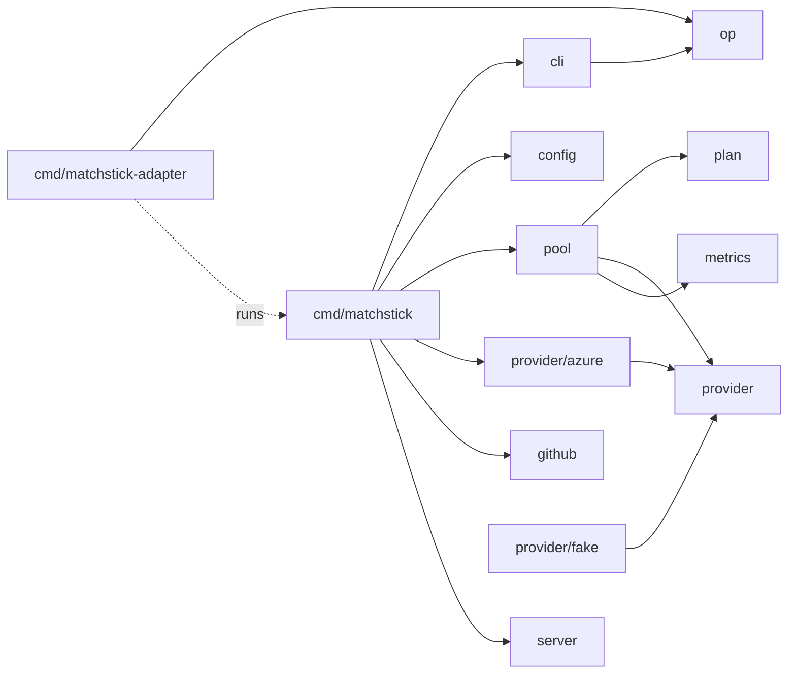
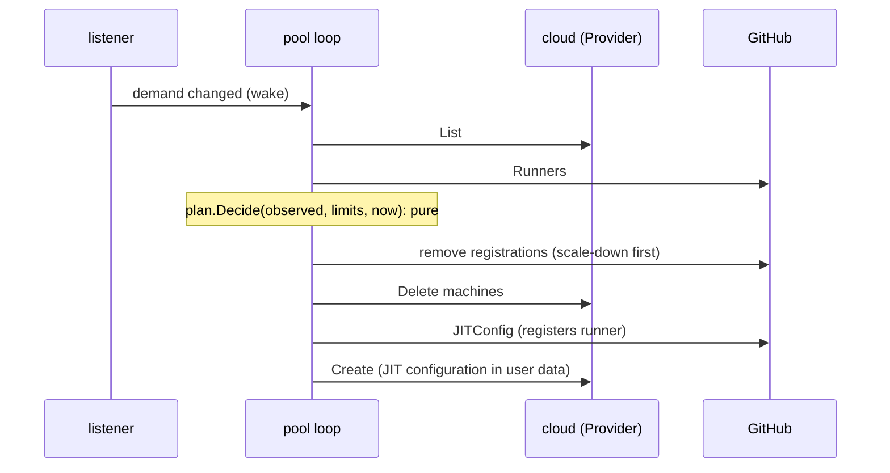

# Architecture

matchstick gives every GitHub Actions job a fresh cloud virtual machine and deletes the machine when the job is done.
It keeps no records of its own: what exists in the cloud and what GitHub reports are the whole picture, read again on
every round. This document describes how it is built, for people changing it.

## What it does

1. It learns how many jobs are waiting for each pool's labels, through GitHub's runner scale sets: a listener holds a
   long-poll session with GitHub, which reports the scale set's job statistics and offers jobs to acquire.
2. It creates a machine for each job, carrying a just-in-time (JIT) runner configuration: a credential that registers
   one runner for one job, after which GitHub removes the registration.
3. It deletes each machine once its job is over, and every machine that went wrong on the way.
4. It never runs more machines than a pool's maximum, nor any machine longer than the pool's maximum lifetime.

It uses the Go client `github.com/actions/scaleset` for the GitHub side.

## Concepts

| Term | Meaning |
|---|---|
| pool | one scale set and the machines serving it: labels, machine shape, limits. One process serves several pools. |
| machine | a cloud VM created by matchstick for a pool, found again through its tags |
| registration | a runner registered with GitHub through a JIT configuration; it has the same name as its machine |
| demand | jobs assigned to the scale set (waiting and running), as the listener last reported |
| round | one gather → plan → act pass for one pool |

Names have the form `<instance>-<pool>-<created><random>`: the installation's name (configured, unique per GitHub
organisation and cloud resource group), the pool's name, the creation time in seconds since the Unix epoch in base 36
(7 characters) and 4 random base-36 characters. A name therefore says who owns the machine or registration, which pool
it serves, and how old it is, without any lookup. Machines also carry tags with the same facts; tags are the cloud's
proof of ownership, names are GitHub's.

## Packages

```
cmd/matchstick/            the program: run (the reconciler) and the one-shot operations; holds the secrets
cmd/matchstick-adapter/    rpc and mcp modes; holds no secrets, runs `matchstick` for each call
internal/op/               the operations: names, JSON Schemas in and out, annotations, input checks
internal/cli/              the command-line adapter: flags, --input, --json, help, errors, exit codes
internal/config/           the configuration file: types, defaults, validation
internal/plan/             the decisions: a pure function from what was observed to what to do
internal/naming/           machine and registration names: building them, reading owner, pool and age back
internal/pool/             one pool's loop: gather, call plan, act; listener handling; drain
internal/provider/         the Provider interface and the Machine type
internal/provider/azure/   Provider on Azure virtual machines
internal/provider/fake/    Provider in memory, for tests and for trying the planner
internal/github/           the GitHub side: scale set, session, JIT configurations, runner list, removal
internal/github/fake/      the GitHub side in memory
internal/secret/           reading secrets from standard input or the platform's secret mount
internal/metrics/          Prometheus collectors
internal/server/           HTTP: /metrics, /healthz on one address; the drain endpoint on a local-only address
```

Dependencies point inwards: `plan` imports only the standard library; `pool` imports `plan`, `provider` and the
GitHub interface it declares; only `cmd/matchstick` knows the concrete implementations and wires them together. This
is a functional core (`plan`: data in, data out, state passed in and returned) inside an imperative shell (everything
that talks to a network, a clock, a file or a terminal).



## Operations

Everything matchstick does that a person, a script or an agent may ask for is an operation, declared once in
`internal/op`: a name, a description, a JSON Schema for its input and one for its output, and four annotations. Every
call is checked against the input schema before it runs and its result against the output schema before it is
returned; a mismatch is a bug and fails the call. The command line, JSON-RPC and MCP are adapters over the same
declarations.

| Operation | Does | Read-only | Destructive | Idempotent | Open world |
|---|---|---|---|---|---|
| `decide` | the pure planner: an observation and a pool's limits in, actions out | yes | no | yes | no |
| `plan` | gathers each pool now and returns what a round would do; changes nothing | yes | no | yes | yes |
| `status` | each pool's machines, registrations and demand as the cloud and GitHub report them | yes | no | yes | yes |
| `drain` | asks the running process to drain a pool, or to stop draining it | no | yes | yes | yes |

`run` is not an operation: it is the long-running reconciler, started by a service manager, and its interfaces are
its logs, its metrics and its health check.

### Command line

The command line follows the conventions of [clig.dev](https://clig.dev/):

- `matchstick <operation> [flags]`; `-h`/`--help` with an example; `--version`.
- Flags are the input schema's property names in kebab-case; `--input <file|->` takes the whole input as JSON keyed as
  in the schema, and flags given as well override it.
- `--json` prints the result as one JSON value on stdout; later versions only add fields. Without it, the output is
  for reading.
- `--help --json` prints the operations as MCP tool definitions (name, description, input and output schemas,
  annotations).
- Exit 0 on success, 2 on invalid input (flags, schema, configuration), 1 on any other failure. With `--json`,
  errors go to stderr as `{"error": {"code": "...", "message": "..."}}`.
- No operation prompts. A missing input fails with a message saying what to pass; `--no-input` is accepted and
  changes nothing.
- Lists are bounded by the pools' maximums (tens of entries), so results are not paged.

### rpc and mcp

The `matchstick` executable holds the secrets. Its third-party code is the scale-set client, the Azure SDK, the
Prometheus client, a YAML parser and a JSON Schema validator, each pinned in `go.mod` and checked by `govulncheck` in
CI.

`matchstick-adapter rpc` (JSON-RPC 2.0, one message per line) and `matchstick-adapter mcp` (MCP over stdio, with the
official Go SDK) live in a separate executable that never holds a secret. For each call it runs
`matchstick <operation> --json --input -` with the call's parameters on standard input, returns the output, and maps
the error object to JSON-RPC's `data.code` or MCP's tool error. Secrets never travel in their parameters: the
`matchstick` it runs reads its own from the secret mount. The reconciler's live state (demand, drain, backoff) stays in
the `run` process; `drain` reaches it over the local admin address, and nothing else needs it. No operation takes long
enough to need progress notifications.

## Secrets

The GitHub credential (a GitHub App's private key, or a token) is read from standard input when `--secrets -` is
given, as `{"githubAppPrivateKey": "..."}` or `{"githubToken": "..."}`, otherwise from the platform's secret mount: a
directory (default `/var/run/secrets/matchstick`) holding the file `github-app-private-key` or `github-token`, as a
Kubernetes Secret or systemd's credentials provide. Never from flags, environment variables, the configuration file,
or output; logs and errors never contain one.

On Azure there is no secret to hold: matchstick signs in with workload identity (Kubernetes), a managed identity (a
VM), or the Azure CLI's sign-in (a workstation), tried in that order. It does not read a client secret from
environment variables.

## Interfaces

Two seams have two implementations each, so they are interfaces; nothing else is.

```go
// provider: one pool's machines in one cloud.
type Provider interface {
	// Create starts a machine and returns once the cloud has accepted it; the machine may still be booting.
	// An error wrapping ErrCapacity means the cloud has no room now (quota, capacity): retry later.
	Create(ctx context.Context, spec CreateSpec) error
	// List returns every machine of this pool, including ones half-created or being deleted.
	List(ctx context.Context) ([]plan.Machine, error)
	// Delete removes a machine and everything created with it. Deleting what is already gone succeeds.
	Delete(ctx context.Context, name string) error
}

type CreateSpec struct {
	Name      string
	JITConfig string    // the runner's single-use configuration, handed to the machine's image
	ExpiresAt time.Time // recorded on the machine; the plan deletes it after this time
}

```

`plan.Machine` is the core's view of a machine: name, state (pending, running, stopped, failed, deleting), creation
time and expiry.

A provider is built for one pool with that pool's settings, so the interface carries no pool settings.

```go
// pool: the GitHub side of one pool.
type GitHub interface {
	JITConfig(ctx context.Context, name string) (config string, runnerID int64, err error)
	Runners(ctx context.Context) ([]plan.Runner, error) // registrations whose names this pool owns
	RemoveRunner(ctx context.Context, id int64) error   // ErrJobRunning if GitHub refuses: a job is running
}
```

The scale-set client offers no way to list a scale set's runners, so `Runners` reads GitHub's REST runner list for
the organisation, repository or enterprise the scale set belongs to, and keeps those whose names carry the pool's
prefix. Each entry has GitHub's `status` (online or offline) and `busy` flag.

The configuration chooses the implementations. Besides Azure and GitHub it accepts `fake`, which serves a pool's
machines, registrations and demand from the configuration itself: `matchstick plan --config examples/fake.yaml`
shows the planner at work without a cloud or a GitHub App. The tests use the same fakes.

## A round

Each pool runs one loop. A round starts when the listener reports news, when the round's timer fires (every 30
seconds by default), or when a drain is requested. Rounds of one pool never overlap; pools run independently.



### Gather

The loop lists the pool's machines from the provider and its registrations from GitHub. The two lists are joined by
name. Demand comes from the listener's last report. If the machine list fails, the round does nothing. If the
registration list fails, the round still applies the rules that need only the machines (stopped, failed and expired
machines) and skips the rest.

### Plan

`plan.Decide` is a pure function: it takes the observation (machines, registrations or "unknown", demand or
"unknown", whether the pool is draining, whether creation is paused) with the pool's limits and the current time, and
returns a decision: machines to delete and registrations to remove, each with a reason, and how many machines to
create. It never calls anything; every rule below is a test of it.

| Rule | Condition | Action |
|---|---|---|
| finished | machine stopped or failed (its image powers it off after the job) | remove its registration if any, delete the machine |
| expired | now is past the machine's expiry (created + the pool's maximum lifetime) | remove its registration if any, delete the machine, even mid-job |
| unregistered | machine running, older than the registration timeout, and GitHub has no registration of its name | delete the machine |
| orphan | registration older than the registration timeout (by its name) with no machine of its name | remove the registration |
| surplus | more ready machines than demand + spares | for each surplus idle registration, oldest first: remove the registration, then delete the machine |
| needed | fewer machines than demand + spares | create machines, never beyond the pool's maximum |

Counting:

- `wanted = min(demand + spares, maximum)`; while draining, `wanted = 0`.
- `serving` = machines pending or running that no rule deletes this round.
- `present` = every machine listed, in any state, including those being deleted or about to be. Machines still
  billing count against the maximum until they are gone.
- creates = `min(wanted − serving, maximum − present)`, at least 0. None while demand is unknown (before the
  listener's first report) or while creation is paused.
- surplus = `serving − wanted`, taken only from registrations that are online and not busy. None while demand is
  unknown.

A surplus machine's registration is removed before the machine is deleted. GitHub refuses to remove a runner that is
running a job, so a runner that took a job in the meantime keeps its machine. For the finished, expired and
unregistered rules the machine is deleted whatever GitHub answers; its job is over or its time is up.

### Act

The loop carries out the actions with a bounded number in flight, in this order: registration removals, machine
deletions (a surplus deletion only after its registration was removed), then creations. Each action is independent;
one failing does not stop the others, and none is retried within the round. The next round observes the result and
plans again, so a failed call is retried by being planned again.

A creation asks GitHub for a JIT configuration under a fresh name, then asks the provider to create a machine with it.
If the provider refuses, the loop removes the registration it just made. If removal fails as well, or the process
stops between the two calls, the registration is an orphan and a later round removes it.

### Backoff

Creation pauses for a pool, in memory, when:

- the provider reports `ErrCapacity` (quota or no capacity): 2 minutes, doubling to 30;
- machines are deleted by the unregistered rule several rounds in a row (they boot but never register: a broken image
  or network): 10 minutes, and the pool reports it in its status and metrics.

Deletions never pause.

### The listener

Each pool holds one message session with GitHub for its scale set, through the scale-set client's listener. The
listener calls the pool's `Scale` for every message. `Scale` records the latest statistics (`TotalAssignedJobs` is the
demand), acquires the jobs offered unless the pool is draining, and wakes the loop. It never calls the cloud, so a slow
cloud never delays acknowledging GitHub's messages. If the session fails, the pool opens a new one after a backoff; the
loop keeps running rounds meanwhile, with the last demand it knew.

## Restart and failure

matchstick keeps nothing between runs. On start, each pool's first round sees every machine and registration that
exists, and the rules apply to them as to any other: machines mid-job keep running; finished, expired and
never-registered ones are deleted; orphan registrations are removed. Demand is unknown until the listener's first
report, so nothing is created or scaled down before it, while cleanup proceeds.

| Failure | Outcome |
|---|---|
| matchstick stopped | queued jobs wait; running jobs finish; their machines power off and still bill until the next start deletes them |
| GitHub unreachable | finished and expired machines are still deleted; nothing is created |
| cloud unreachable | nothing happens for that pool; the health check fails once no round has succeeded for a while |
| quota or capacity | creation backs off; on Azure a Spot pool falls back to regular priority first |
| crash between JIT configuration and machine | the registration is an orphan, removed after the registration timeout |
| crash during a creation the cloud accepted | the machine is listed next round and counted |
| machine never registers | deleted after the registration timeout; repeated, the pool pauses creation |
| Spot eviction | Azure deletes the VM; GitHub fails the job; the registration is an orphan, removed |
| two copies running | the second cannot open the message sessions and keeps retrying; run one replica, replaced rather than overlapped |

## Drain

`matchstick drain --pool <pool>` asks the running process, on its local admin address, to drain a pool: it stops acquiring
jobs, creates nothing, removes idle runners as surplus, and lets busy ones finish. `status` shows when a pool has no
machines and no registrations left. A drain lasts until the process restarts; to keep a pool empty, set its maximum to
0 in the configuration.

## The image

The machine's image does the rest, described in [image-contract.md](image-contract.md): read the JIT configuration
from the cloud's instance metadata, run GitHub's runner with it for one job, power off when the runner exits.

## Azure

The Azure provider creates, per machine, one network interface in the configured subnet with no public address, and
one VM from a Compute Gallery image, with the JIT configuration as user data. The VM's OS disk and network interface are
created with delete-with-VM set, so one VM deletion removes them. Options per pool: VM size, image version, a
user-assigned managed identity or none, the OS disk on the VM's local (resource or cache) disk as an ephemeral disk,
Spot priority with fallback to regular priority on a capacity error, accelerated networking, a cloud-init file as
custom data. Quota and allocation failures are reported as `ErrCapacity`. It signs in as described under Secrets.

## Observability

- Logs: JSON on stdout, one line per action with pool, machine and reason.
- Metrics on `/metrics`: demand, machines by state, registrations by status, creations, creation failures by kind,
  deletions and registration removals by reason, rounds and their duration, time of the last successful round, whether
  creation is paused.
- `/healthz`: healthy while every pool has completed a round recently (three intervals).

## Limits

- Each machine serves one job; machines are never reused or kept stopped for later.
- No spending cap in money: the limits are machines per pool and lifetime per machine.
- One replica. A second copy waits rather than doubles the work.
- Two installations must not share an instance name in the same GitHub organisation or resource group.
- It does not make the network, identities, images or role assignments; they must exist beforehand.
- Scale sets are created or updated on start and never deleted.
- Azure only. Another cloud means another implementation of `Provider` (three methods).
