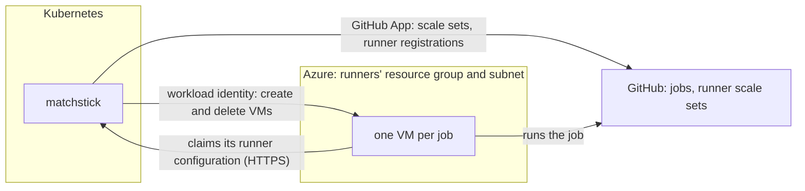

# Setting up matchstick

From nothing to a first job on your own runners: a GitHub App, Azure, and matchstick on Kubernetes with its Helm chart.
The examples use an organisation called `acme`; replace the names with yours.



## What you need

| What | For |
|---|---|
| owner of the GitHub organisation (or admin of the repository) | creating and installing the GitHub App |
| an Azure subscription where you can create resource groups, roles, role assignments and managed identities | the runners' resources and matchstick's identity |
| a Kubernetes cluster on Azure with workload identity (AKS: `--enable-oidc-issuer --enable-workload-identity`), in or peered with the runners' virtual network | running matchstick |
| `kubectl`, `helm` 3.8 or later, `az`, `cosign`, `yq` | the commands below |
| the `matchstick` binary for your computer, from the [latest release](https://github.com/fakta-ai/matchstick/releases) (`matchstick_<version>_<os>_<arch>.tar.gz`, checked against `checksums.txt`) | creating and checking the GitHub App |

Runners can serve an organisation or a single repository, on github.com, GitHub Enterprise Cloud (including
`*.ghe.com`) or GitHub Enterprise Server. Runners of a whole enterprise cannot be registered by a GitHub App; they need
a token (a classic personal access token with `manage_runners:enterprise`) in the secret instead of the App's key.

## 1. Create the GitHub App

### With matchstick

```sh
mkdir -p secrets
matchstick github-app create --org acme --name acme-runners --key-file secrets/github-app-private-key
```

matchstick opens a page in your browser, served on `127.0.0.1` only, that sends the App's definition to GitHub. Sign in
to GitHub as an owner of `acme` if asked, check the name, and select **Create GitHub App**. GitHub sends the browser
back to matchstick, which prints the App as JSON and writes its private key to `secrets/github-app-private-key` with
mode 0600:

```json
{
  "appID": 1234567,
  "clientID": "Iv23liAcmeExample",
  "slug": "acme-runners",
  "name": "acme-runners",
  "owner": "acme",
  "htmlURL": "https://github.com/apps/acme-runners",
  "installURL": "https://github.com/apps/acme-runners/installations/new",
  "keyFile": "secrets/github-app-private-key"
}
```

- Runners for one repository: `--repo acme/widgets` instead of `--org acme`.
- GitHub Enterprise Server or `*.ghe.com`: add `--host https://github.acme.com`.
- No browser opens (a remote shell): add `--no-browser` and open the printed address in a browser on the same
  computer; the page listens on `127.0.0.1` only.
- matchstick waits 15 minutes for GitHub's answer (`--timeout`, at most `1h`).

The App is private to its owner, has no webhook, and has only the permissions in the table below.

### By hand

In GitHub, open **Settings → Developer settings → GitHub Apps → New GitHub App** of the organisation (for a
repository's runners, of the repository's owner):

- **GitHub App name**: any, such as `acme-runners`; **Homepage URL**: any.
- **Webhook**: clear **Active**. matchstick uses no webhook.
- **Permissions**:

  | Runners of | Permission | Access |
  |---|---|---|
  | an organisation | Organization permissions → **Self-hosted runners** | Read and write |
  | a repository | Repository permissions → **Administration** | Read and write |
  | either | Repository permissions → **Metadata** | Read-only |

- **Where can this GitHub App be installed?**: **Only on this account**.

Select **Create GitHub App**, note its **Client ID**, then under **Private keys** select **Generate a private key**. Save
the downloaded file as `secrets/github-app-private-key`.

## 2. Install the App

Open the `installURL` (or the App's page → **Install App**) and install it on `acme`. matchstick reads no repository's
contents, so for an organisation's runners any repository selection works; for a repository's runners, select that
repository.

The installation's ID ends the address GitHub shows next, such as
`https://github.com/organizations/acme/settings/installations/56789012`: `56789012`. It goes into the configuration as
`github.app.installationID`, with the client ID as `github.app.clientID`.

## 3. Store the key

matchstick reads the GitHub credential from its secret mount, `/var/run/secrets/matchstick`: the file
`github-app-private-key` (the App's PEM key) or `github-token` (a token), never both. The Helm chart mounts a
Kubernetes Secret there, named by `githubSecret.name` (default `matchstick-github`), which you create; matchstick reads
it when it starts, so restart it after replacing the key.

**A Secret made by hand:**

```sh
kubectl create namespace matchstick
kubectl -n matchstick create secret generic matchstick-github \
  --from-file=github-app-private-key=secrets/github-app-private-key
```

**A Secret filled from your vault**, by the [External Secrets Operator](https://external-secrets.io/). Put the key in
the vault (here Azure Key Vault, `acme-vault`), then let the operator keep the Secret in step with it:

```sh
az keyvault secret set --vault-name acme-vault --name matchstick-github-app-private-key \
  --file secrets/github-app-private-key
```

```yaml
apiVersion: external-secrets.io/v1
kind: ExternalSecret
metadata:
  name: matchstick-github
  namespace: matchstick
spec:
  refreshInterval: 1h
  secretStoreRef:
    kind: ClusterSecretStore
    name: acme-vault          # your store for the vault
  target:
    name: matchstick-github   # the chart's githubSecret.name
  data:
    - secretKey: github-app-private-key
      remoteRef:
        key: matchstick-github-app-private-key
```

The [Secrets Store CSI driver](https://secrets-store-csi-driver.sigs.k8s.io/) can fill the same Secret through its
sync to Kubernetes Secrets (`secretObjects`). Either way, delete the local copy of the key once it is stored.

## 4. Prepare Azure

The commands use these names; matchstick needs only the resource IDs.

| Name | What |
|---|---|
| `acme-runners` | the resource group the runners' VMs and network interfaces go into; keep nothing else in it |
| `acme-network` / `acme-vnet` / `runners` | the resource group, virtual network and subnet for the runners |
| `acme-images` / `acme-gallery` / `runner` | the Compute Gallery and image definition of the runner image |
| `acme-identities` / `matchstick` | matchstick's own managed identity |

### Resource group and subnet

```sh
az group create --name acme-runners --location westeurope
az network vnet subnet create --resource-group acme-network --vnet-name acme-vnet --name runners \
  --address-prefixes 10.20.8.0/22
```

Runners get a private address in the subnet and no public one. The subnet needs outbound HTTPS to GitHub (through a
NAT gateway or a firewall), and must reach matchstick's claim endpoint, a Service in the cluster (step 6).

### Runner image

Runners boot from a Linux image in an Azure Compute Gallery. The image must meet the
[image contract](image-contract.md): claim the runner's configuration from matchstick, run GitHub's runner once, and
power off. [examples/cloud-init.yaml](../examples/cloud-init.yaml) does that on Ubuntu as the pool's
`azure.customData`, so a generalized Ubuntu image with cloud-init and Python 3 is enough; build it into the gallery
with Packer or Azure VM Image Builder. The pool's VM size must support the image's Hyper-V generation.

### Role

matchstick creates, reads and deletes VMs and network interfaces in the runners' resource group, joins network
interfaces to the subnet, reads the image, and attaches each pool's identity to its VMs. This custom role allows
exactly those actions:

```json
{
  "Name": "matchstick runners",
  "Description": "Create, read and delete runner VMs and their network interfaces.",
  "Actions": [
    "Microsoft.Compute/virtualMachines/read",
    "Microsoft.Compute/virtualMachines/write",
    "Microsoft.Compute/virtualMachines/delete",
    "Microsoft.Compute/virtualMachines/instanceView/read",
    "Microsoft.Compute/disks/read",
    "Microsoft.Compute/disks/write",
    "Microsoft.Compute/disks/delete",
    "Microsoft.Network/networkInterfaces/read",
    "Microsoft.Network/networkInterfaces/write",
    "Microsoft.Network/networkInterfaces/delete",
    "Microsoft.Network/networkInterfaces/join/action",
    "Microsoft.Network/virtualNetworks/subnets/join/action",
    "Microsoft.Compute/galleries/read",
    "Microsoft.Compute/galleries/images/read",
    "Microsoft.Compute/galleries/images/versions/read",
    "Microsoft.ManagedIdentity/userAssignedIdentities/assign/action"
  ],
  "AssignableScopes": ["/subscriptions/<subscription-id>"]
}
```

| Actions | Why |
|---|---|
| `virtualMachines/*`, `instanceView/read` | create, list, read (power state; matching a claim to its VM) and delete the VMs |
| `disks/*` | each VM's OS disk, created with the VM and deleted with it |
| `networkInterfaces/*`, `join/action` | each VM's network interface, created before it and deleted with it |
| `subnets/join/action` | the network interface's place in the subnet |
| `galleries/…/read` | the pools' image |
| `userAssignedIdentities/assign/action` | a pool's `azure.identity`, if it has one |

```sh
az role definition create --role-definition @matchstick-role.json
```

matchstick acts only on VMs and network interfaces it tagged as its own, in the one resource group.

### matchstick's identity

matchstick signs in to Azure with workload identity: a user-assigned managed identity that trusts the chart's service
account (`matchstick` in namespace `matchstick`, for a release named `matchstick`).

```sh
az identity create --resource-group acme-identities --name matchstick
issuer=$(az aks show --resource-group acme-aks --name acme --query oidcIssuerProfile.issuerUrl --output tsv)
az identity federated-credential create --resource-group acme-identities --identity-name matchstick \
  --name matchstick --issuer "$issuer" --subject system:serviceaccount:matchstick:matchstick \
  --audiences api://AzureADTokenExchange
principal=$(az identity show --resource-group acme-identities --name matchstick --query principalId --output tsv)
```

Assign the role where each part lives:

```sh
sub=$(az account show --query id --output tsv)
for scope in \
  /subscriptions/$sub/resourceGroups/acme-runners \
  /subscriptions/$sub/resourceGroups/acme-network/providers/Microsoft.Network/virtualNetworks/acme-vnet/subnets/runners \
  /subscriptions/$sub/resourceGroups/acme-images/providers/Microsoft.Compute/galleries/acme-gallery; do
  az role assignment create --assignee-object-id "$principal" --assignee-principal-type ServicePrincipal \
    --role "matchstick runners" --scope "$scope"
done
```

A pool with `azure.identity` also needs the role on that identity (its resource ID as `--scope`). Give pools that run
untrusted code no identity.

## 5. Configure

Write the chart's values, `values.yaml`, with matchstick's [configuration](configuration.md) under `config`:

```yaml
config:
  instance: ci
  claimURL: https://10.20.0.40:8443/claim
  github:
    url: https://github.com/acme
    runnerGroup: default
    app:
      clientID: Iv23liAcmeExample
      installationID: 56789012
  azure:
    subscriptionID: <subscription-id>
    resourceGroup: acme-runners
    location: westeurope
    subnetID: /subscriptions/<subscription-id>/resourceGroups/acme-network/providers/Microsoft.Network/virtualNetworks/acme-vnet/subnets/runners
  pools:
    - name: linux
      labels: [acme-linux]
      maximum: 4
      azure:
        size: Standard_D4ads_v5
        image: /subscriptions/<subscription-id>/resourceGroups/acme-images/providers/Microsoft.Compute/galleries/acme-gallery/images/runner
        ephemeralOSDisk: ResourceDisk
        customData: /etc/matchstick/cloud-init.yaml
githubSecret:
  name: matchstick-github
serviceAccount:
  azureClientID: <client ID of the matchstick identity>
claim:
  service:
    annotations:
      service.beta.kubernetes.io/azure-load-balancer-internal: "true"
      service.beta.kubernetes.io/azure-load-balancer-ipv4: 10.20.0.40
```

- `claimURL` is where the runners reach the claim endpoint: the chart's claim Service, an internal load balancer.
  Fixing its address with the annotation, an unused address in the cluster's subnet, lets `claimURL` name it before
  the Service exists.
- `github.url` is `https://github.com/acme/widgets` for a repository's runners; their `runnerGroup` is `default`.
- `customData` names a file in the pod: the chart's `files` value puts files next to the configuration, in
  `/etc/matchstick` (step 6). Leave it out when the image itself claims and runs the runner as the image contract
  says.

Check the GitHub side before installing, from the same configuration and key (here with the key file from step 1):

```sh
yq '.config' values.yaml > matchstick.yaml
matchstick github-app check --config matchstick.yaml --secrets-dir secrets
```

```json
{
  "ok": true,
  "app": "acme-runners",
  "installationID": 56789012,
  "runnerGroupID": 1,
  "checks": [
    {"name": "key", "status": "pass", "detail": "GitHub accepts the key's JWT: App acme-runners (ID 1234567)"},
    {"name": "installation", "status": "pass", "detail": "App acme-runners is installed on acme as installation 56789012"},
    {"name": "permissions", "status": "pass", "detail": "the installation has metadata: read, organization_self_hosted_runners: write"},
    {"name": "runnerGroup", "status": "pass", "detail": "runner group Default (ID 1) is one the App can use"}
  ]
}
```

A failed check says what to change, and the command exits with 1. It changes nothing on GitHub.

## 6. Install

Each release signs its chart and image with Sigstore; the release notes give their digests. Pull the chart, check that
its digest is the release's and that the release workflow signed it, then install that file:

```sh
version=<version>
helm pull oci://ghcr.io/fakta-ai/charts/matchstick --version $version   # prints the chart's Digest
cosign verify ghcr.io/fakta-ai/charts/matchstick@sha256:<chart digest> \
  --certificate-oidc-issuer https://token.actions.githubusercontent.com \
  --certificate-identity https://github.com/fakta-ai/matchstick/.github/workflows/release.yml@refs/tags/v$version
cosign verify ghcr.io/fakta-ai/matchstick@sha256:<image digest> \
  --certificate-oidc-issuer https://token.actions.githubusercontent.com \
  --certificate-identity https://github.com/fakta-ai/matchstick/.github/workflows/release.yml@refs/tags/v$version

helm install matchstick matchstick-$version.tgz --namespace matchstick -f values.yaml \
  --set image.digest=sha256:<image digest> \
  --set-file 'files.cloud-init\.yaml=cloud-init.yaml'
```

`cloud-init.yaml` is your copy of [examples/cloud-init.yaml](../examples/cloud-init.yaml); the pod sees it as
`/etc/matchstick/cloud-init.yaml`, next to the configuration, `/etc/matchstick/matchstick.yaml`.

Then check from inside the pod, with exactly what `run` uses:

```sh
kubectl -n matchstick exec deploy/matchstick -- matchstick github-app check --config /etc/matchstick/matchstick.yaml
kubectl -n matchstick exec deploy/matchstick -- matchstick status --config /etc/matchstick/matchstick.yaml
```

## 7. First job

```yaml
# .github/workflows/hello.yml in a repository of acme
on: workflow_dispatch
jobs:
  hello:
    runs-on: acme-linux
    steps:
      - run: echo "on $(hostname)"
```

Run the workflow. matchstick creates a VM named `ci-linux-…` in `acme-runners`; within a few minutes its runner
registers, takes the job, and the VM powers off and is deleted. `matchstick status` shows each step, and
[operations.md](operations.md) covers watching, draining and upgrading.

A pool's scale set is visible to the runner group's repositories. On an organisation, the `default` group serves its
private repositories; to serve public repositories, or to limit which repositories may use the runners, change the
group's settings under **Settings → Actions → Runner groups**.
