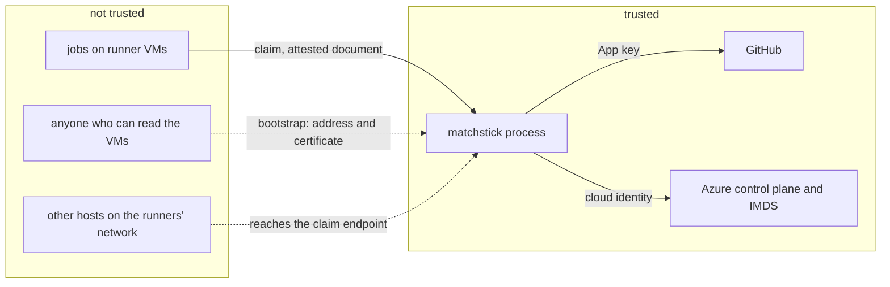

# Threat model

What matchstick protects, whom it trusts, what it does against each threat, and what is left to you. It describes
the code as it is, on Azure. How the claim works in detail: [architecture.md](architecture.md#claims); what a
runner image must do: [image-contract.md](image-contract.md); reporting a flaw: [SECURITY.md](../SECURITY.md).

## What it protects

| Asset | Where it lives | Who could use it, and for what |
|---|---|---|
| runner registrations (JIT configurations) | matchstick's memory, from just before a VM is created until that VM claims it, or the registration timeout passes | anyone holding one can register a runner under that name and receive the job GitHub assigns to it, with the job's secrets |
| the GitHub credential (an App's private key, or a token) | standard input or the secret mount, then matchstick's memory | anyone holding it can register runners with your pools' labels in your organisation, repository or enterprise, and receive your jobs |
| matchstick's cloud identity | the platform's workload identity (or a managed identity, or a CLI sign-in); no client secret | anyone signed in as it can create, read and delete VMs and network interfaces where its role reaches, and attach the pools' identities |
| the claim endpoint's TLS key | matchstick's memory only, made at start | anyone holding it can pose as the endpoint to machines whose bootstrap names its certificate |

## Whom it trusts

| Party | Trusted? | What that means |
|---|---|---|
| GitHub | yes | its JIT configurations, job assignments and runner lists are taken as they come |
| the cloud's control plane and instance metadata (IMDS) | yes | its VM listings, tags and `vmId`s are the truth; an attested document signed by a certificate for `metadata.azure.com` that chains to Microsoft's Azure roots proves which VM sent it |
| the runner image's boot code, before it claims | yes | it is the only code on the VM that may hold the attested document before the claim |
| jobs running on runner VMs | **no** | they are arbitrary code from your workflows (and, if you allow it, from pull requests) |
| anyone allowed to read the VMs in the cloud | **no** | they see every VM setting: user data, custom data, tags, extensions, the OS profile |
| other hosts on the runners' network | **no** | they can reach the claim endpoint and anything else the network allows |
| whoever reaches the claim endpoint | **no** | every request is checked on its own; nothing about the sender's address is trusted |

## Threats, mitigations, and what remains

| Threat | What matchstick does | What remains |
|---|---|---|
| **Taking a registration from a VM's settings** | no secret is put in any VM setting; user data holds only the machine's name, the claim URL and the endpoint's certificate, all public | nothing |
| **Claiming another VM's registration** | a claim needs an attested document Microsoft signed for that VM: the document's `vmId` must be the named VM's, the VM must carry the pool's tags, the document must be current (5 minutes' clock skew allowed) and for the configured subscription | a process inside the VM before the runner claims can claim first: the image must run nothing else before it |
| **Replaying a registration or a document** | a configuration is taken out of memory as it is released, so it is released once; a second claim, a replayed document or a job on the VM fetching its own document gets `refused` | a document stays valid for hours, but once its VM has claimed it opens nothing |
| **A job registering a second runner** | after release nothing is held for the VM; the JIT configuration is single-use and names one runner | nothing |
| **Denying a VM its registration with forged claims** | a claim whose proof fails is refused without dropping the configuration; the real VM can still claim | requests are checked one by one with no rate limit; a host that can reach the endpoint can use its CPU (bodies up to 64 KiB, 30 seconds each) |
| **Reading a registration in transit** | the claim is TLS; the VM trusts only the certificate in its bootstrap, never the system's roots | nothing |
| **A fake claim endpoint** | its key never leaves matchstick's memory; a host answering at the claim URL without it fails the VM's TLS check, and the VM sends nothing | an endpoint that refuses or never answers keeps the VM from running a job; the VM powers off and is replaced |
| **A forged attested document** | the PKCS#7 signature is checked, the signer must be `metadata.azure.com` or a subdomain, its chain must end at the embedded Azure roots; missing intermediates are downloaded only from the hosts Microsoft lists, at most 64 KiB and 10 seconds each | trust rests on Microsoft's roots and IMDS |
| **A job outliving its job** | a VM older than the pool's `maxLifetime` is deleted whatever it is doing; a stopped VM is deleted on the next round | until then the job keeps the VM, its network and its identity |
| **A job using the VM's identity or network** | each pool sets its identity, or none | what the identity and network reach, the job reaches: give pools that run untrusted code no identity, and a network that reaches nothing it shouldn't |
| **A leaked GitHub credential** | it is read only from standard input or the secret mount; never from flags, environment variables or the configuration file; it prints as redacted and is never logged; the process holding it links only matchstick's own code and its pinned dependencies, and `matchstick-adapter` (JSON-RPC, MCP) runs separately without it | whoever holds it can register runners with your labels and receive your jobs and their secrets until you revoke the key in GitHub |
| **A compromised matchstick** | the image has no shell and runs as a non-root user; the chart adds a read-only root file system, no capabilities and no service-account token; the drain endpoint listens on a loopback address only | it holds the GitHub credential and the cloud identity: everything they allow is open to it. Keep both as narrow as the configuration pages say |
| **Cost exhaustion** | each pool has a `maximum` number of VMs in any state, and each VM a `maxLifetime`; demand beyond the maximum waits in GitHub's queue; repeated capacity errors and VMs that never register pause creation | anyone who can start workflows with your labels can keep every pool at its maximum; a VM that powered off bills until the next round deletes it, and while matchstick is stopped, until it starts again |
| **Orphaned VMs and registrations** | ownership is in names and tags, read again each round: stopped, failed, expired and never-registered VMs are deleted; a network interface left without its VM is deleted after two minutes; a registration without its VM is removed after the registration timeout | two installations sharing an instance name in one organisation or resource group would delete each other's machines |
| **A tampered release** | releases are built from version tags by the release workflow on GitHub's hosted runners; the workflow's actions are pinned to commits; Go modules are pinned by `go.sum` and the Nix build's `vendorHash`; Nix inputs by `flake.lock`; binaries come with `checksums.txt`; the image is built by Nix from those inputs, with no base image; the image and the Helm chart are signed with Sigstore, keyless, for the release workflow at the version's tag, and recorded in Sigstore's public log; [operations.md](operations.md#installing) says how to verify them. A deployment that pins digests and verifies them gets exactly what the workflow built | the binaries carry checksums, not signatures; a release is as trustworthy as the repository's tags and its workflow |

## What you must provide

- **Network:** only the runners' subnets reach the claim endpoint, directly, with nothing terminating TLS in front of
  it. matchstick itself needs HTTPS to GitHub and the cloud's API, and HTTP to the certificate hosts above.
- **A role scoped to the runners:** on the resource group that holds only runner VMs, create, read and delete VMs and
  network interfaces; outside it, only join the runners' subnet, read the runner image and assign each pool's
  identity ([configuration.md](configuration.md#azure)).
- **A GitHub App with the least permission:** Self-hosted runners read and write on an organisation (Administration on
  a repository), installed only where it is used. Limit which repositories may use the runner group, and don't let
  pull requests from forks run on these runners.
- **Pool bounds and a budget:** set each pool's `maximum` and `maxLifetime` to what you are willing to pay, and set a
  budget alert on the runners' resource group. Watch `matchstick_last_success_timestamp_seconds`
  ([operations.md](operations.md#watching)): finished VMs keep billing while matchstick is stopped.
- **A runner image that meets the contract**, running nothing before the claim, and a unique `instance` per
  installation.
